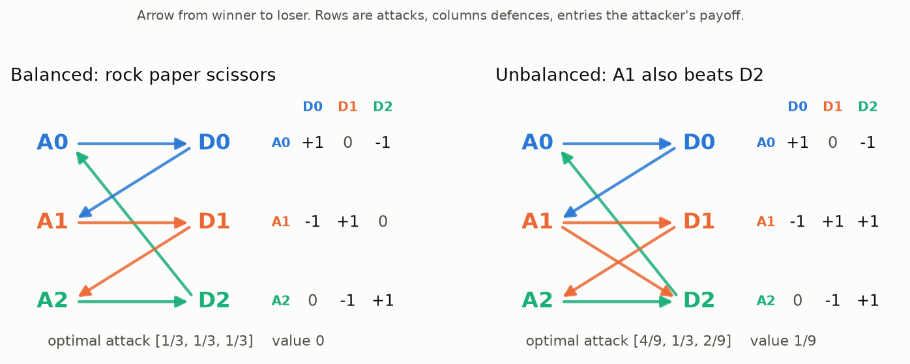
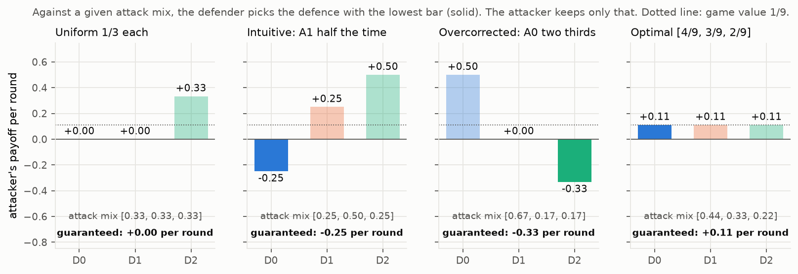
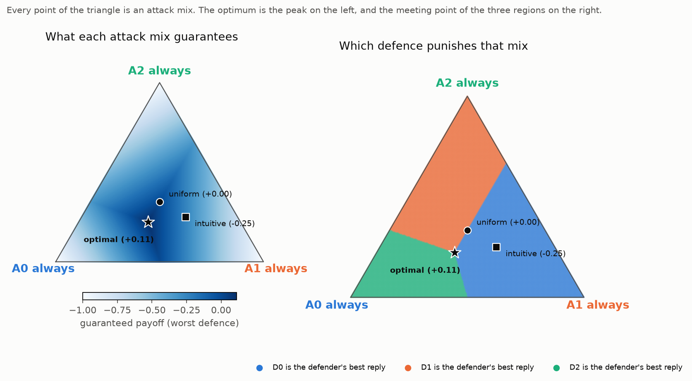
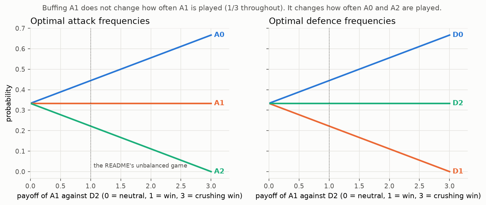
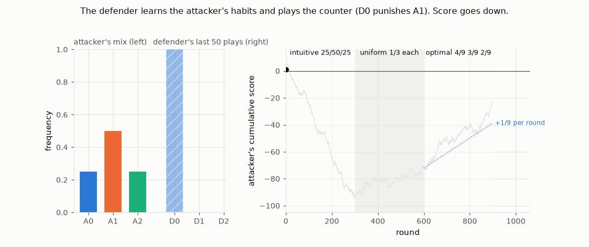
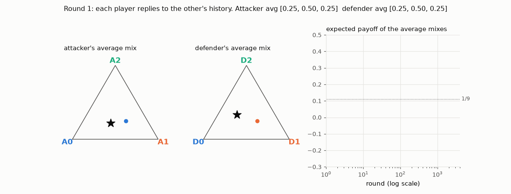

# Generalised rock paper scissors solver

Two players pick at the same time. The attacker picks a row, the defender picks a column, the cell is the attacker's payoff (+1 win, -1 loss, 0 nothing). Rock paper scissors is the balanced case. This repository solves the unbalanced cases: what to play when one option beats more things than the others.

Interactive version: [docs/index.html](docs/index.html) (matrix editor, draggable strategy landscape, a reader to play against).

<p align="center"></p>

## The result

Optimal play is the mix whose worst case is best: the strategy an opponent gains nothing from knowing. Rock paper scissors solves to a third each. In the unbalanced game, A1 beats two defences, and the optimal play is

```
attack  = [4/9, 3/9, 2/9]     defence = [4/9, 2/9, 3/9]     value = 1/9 per round
```

The option that wins against two defences is played less than the option that wins against one.

## Why

Against a fixed attack mix, a defender who knows it picks the defence with the lowest payoff for the attacker. The attacker keeps only that lowest bar.

<p align="center"></p>

Playing A1 half the time hands the defender D0 (the only defence that beats A1) and loses 0.25 per round. The optimum is the mix where the three bars are level: the defender has nothing to choose, so knowing the mix is worthless. Those equalities are the whole solver:

```
D0 earns the attacker  A0 - A1
D1 earns the attacker  A1 - A2
D2 earns the attacker  -A0 + A1 + A2
all equal, A0 + A1 + A2 = 1   →   [4/9, 3/9, 2/9], each worth 1/9
```

Over the whole triangle of attack mixes, the guaranteed payoff peaks where the three best-reply regions meet:

<p align="center"></p>

The frequency of A1 is set by `A0 - A1 = A1 - A2`, which does not involve how hard A1 beats D2. Buff A1 from a neutral trade to a crushing win and A1 stays at exactly one third. The extra strength goes to A0: the defender leans on D0 to hold A1, and A0 is what punishes D0.

<p align="center"></p>

Your frequencies are decided by the opponent's incentives, not by your options' strength.

## Being read, and convergence

A fixed habit is income for an adapting opponent. Here the defender best-replies to what it has seen: the intuitive mix loses, the uniform mix is held at zero, the optimal mix drifts up at 1/9 per round whatever the defender does.

<p align="center"></p>

When both players adapt to each other's history (fictitious play), their average mixes spiral into the optimum and the payoff settles on the value:

<p align="center"></p>

## Beyond the optimum

The optimal mix is a floor, not a ceiling: it takes exactly the value from everyone and never more. Winning against weaker opponents needs a model of them and a bound on the risk taken. See [docs/exploitation.md](docs/exploitation.md) (learners, a reader, safe exploitation, and how many rounds it takes to prove an edge).

Fighting games can be read as a sequence of such matrices, one per situation, with entries that depend on the game state. See [docs/fighting-games.md](docs/fighting-games.md) (a solved ledge situation, mechanics versus reading, and how to rate players from match logs).

## Install and run

```
pip install -r requirements.txt          # sympy, for solver.py only
python rps_solver.py "1 0 -1; -1 1 1; 0 -1 1"    # exact solver, standard library
python solver.py "1 0 -1; -1 1 1; 0 -1 1"        # symbolic indifference method
python brute_force.py "1 0 -1; -1 1 1; 0 -1 1"   # grid search
```

Rows are attacks, columns defences. Any real payoffs work, for example a high-risk A0: `"1.5 0 -1.5; -1 1 1; 0 -1 1"`. Non-square matrices work with `rps_solver.py`.

`solver.py` equalises every defence, which is only right when the optimal play uses every option on both sides. It now checks that and falls back to `rps_solver.py` otherwise. Details and the review of the original code: [docs/verification.md](docs/verification.md).

Development:

```
pip install -r requirements-dev.txt
python -m pytest -q tests
python explain/figures.py && python explain/animations.py   # regenerate images/
```

## Files

| | |
|---|---|
| `rps_solver.py` | exact solver (Shapley-Snow enumeration), best replies, exploitability |
| `solver.py` | original symbolic solver, certified |
| `brute_force.py` | grid search |
| `explain/` | figure, animation, tournament and fighting-game scripts |
| `docs/` | interactive page and companion documents |
| `tests/` | pytest suite |
