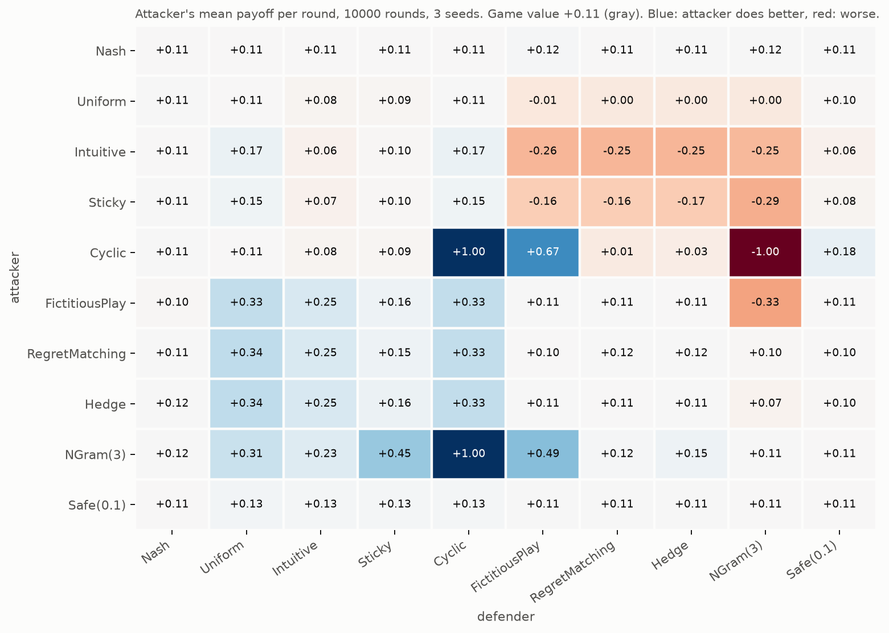
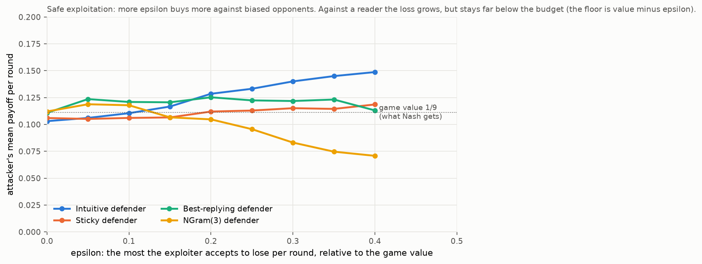
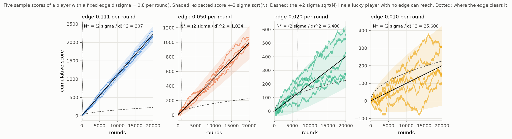

# Beyond the optimal mix: exploitation

The solver finds the mix that a defender who knows your strategy can least abuse. That is a floor. This note is about the ceiling: winning more than the floor against opponents who do not play optimally, without giving the floor away.

## The optimal mix is a floor, not a ceiling

Against the optimal attack [4/9, 3/9, 2/9], every defence yields exactly 1/9 per round. So the optimal attacker takes 1/9 per round from every defender: the naive one, the adaptive one, the one reading its history. Never less, and never more.

In the balanced game the value is 0. The optimal player cannot lose in expectation, and cannot win either: against a defender who always plays D0, uniform play still scores 0. Optimal play is unbeatable, not victorious.

The tournament below (unbalanced game, 10000 rounds, 3 seeds) shows this as a flat row and a flat column at +0.11 for Nash, whatever the opponent.



## Exploitation means modelling

To take more than the value, a player has to guess what the opponent will do and reply to that guess. Every adaptive player in `explain/agents.py` is a model plus a best reply:

* FictitiousPlay: best reply to the opponent's frequencies so far.
* RegretMatching and Hedge: play in proportion to what each option would have earned.
* NGram(3): predict the next move from the last three, best reply to the prediction.

Against the "Intuitive" attacker (A1 half the time), a learner takes about +0.25 per round where Nash takes +0.11. Against a cyclic player, NGram(3) takes the maximum, +1.00.

Every model can be wrong, so every exploiter is itself exploitable:

* FictitiousPlay is deterministic. NGram(3) reads it and takes +0.49 as an attacker (and holds the FictitiousPlay attacker to -0.33 as a defender).
* The Sticky player avoids repeating its last move. That rule is a pattern: NGram(3) takes +0.45 from it, more than from the Intuitive player whose bias is larger but memoryless.
* A Cyclic defender takes 0 from RegretMatching but is crushed by NGram; FictitiousPlay beats the Cyclic defender only because both are deterministic and happen to fall into a favourable loop.

Nothing here beats Nash. Reading only pays against players who have something to read.

## Safe exploitation

The trade-off has a clean formulation: choose a budget epsilon, and only deviate from the optimal mix as far as a perfect counter could punish you by epsilon per round. `SafeExploiter(epsilon)` models the opponent's frequencies, computes the best reply, and plays the mix `(1 - a) * Nash + a * best_reply` with the largest `a` such that the mix's exploitability (game value minus what the mix guarantees) stays under epsilon. With epsilon = 0 it is exactly Nash.



Against a biased defender the gain grows with epsilon (+0.11 to +0.15). Against the NGram reader the exploiter's own deviations are read and it drops to +0.07 at epsilon = 0.4, still far above the floor of 1/9 - 0.4. The floor is a worst case over all defences, and the reader has to learn the deviation before it can punish it.

This is the approach of Ganzfried and Sandholm, "Safe Opponent Exploitation" (ACM Conference on Electronic Commerce, 2011; ACM Transactions on Economics and Computation, 2015), who show the budget can also be accumulated: profit taken earlier can be risked later without lowering the guaranteed total. Pattern exploitation has a long history in computer rock paper scissors; Iocaine Powder, winner of the first International RoShamBo Programming Competition (1999), works by running a set of predictors and meta-predictors and betting on whichever has been right recently.

## What "beating someone" means

A per-round edge d is a drift on a random walk. With per-round standard deviation sigma (about 0.8 for payoffs in {-1, 0, 1}), after N rounds the score is around `d N`, give or take `2 sigma sqrt(N)`. A player with no edge at all reaches `+2 sigma sqrt(N)` about 2.5% of the time, so an edge is only visible once `d N` clears that line:

    N* = (2 sigma / d)^2

* Nash on the unbalanced game, d = 1/9: about 200 rounds.
* d = 0.05: about 1000 rounds.
* d = 0.02: about 6400 rounds.
* d = 0.01: about 25000 rounds. A 1% edge cannot be confirmed in 10000 games.



The consequence for exploitation: reading pays fast against strongly biased opponents and is nearly invisible against slightly biased ones, while the risk (epsilon) is paid on every round.

## Tournament results

Attacker's mean payoff per round, unbalanced game, 10000 rounds, mean of 3 seeds. Game value +0.111.

| attacker \ defender | Nash | Uniform | Intuitive | Sticky | Cyclic | FictPlay | RegretM | Hedge | NGram(3) | Safe(0.1) |
|---|---|---|---|---|---|---|---|---|---|---|
| Nash | +0.11 | +0.11 | +0.11 | +0.11 | +0.11 | +0.12 | +0.11 | +0.11 | +0.12 | +0.11 |
| Uniform | +0.11 | +0.11 | +0.08 | +0.09 | +0.11 | -0.01 | +0.00 | +0.00 | +0.00 | +0.10 |
| Intuitive | +0.11 | +0.17 | +0.06 | +0.10 | +0.17 | -0.26 | -0.25 | -0.25 | -0.25 | +0.06 |
| Sticky | +0.11 | +0.15 | +0.07 | +0.10 | +0.15 | -0.16 | -0.16 | -0.17 | -0.29 | +0.08 |
| Cyclic | +0.11 | +0.11 | +0.08 | +0.09 | +1.00 | +0.67 | +0.01 | +0.03 | -1.00 | +0.18 |
| FictitiousPlay | +0.10 | +0.33 | +0.25 | +0.16 | +0.33 | +0.11 | +0.11 | +0.11 | -0.33 | +0.11 |
| RegretMatching | +0.11 | +0.34 | +0.25 | +0.15 | +0.33 | +0.10 | +0.12 | +0.12 | +0.10 | +0.10 |
| Hedge | +0.12 | +0.34 | +0.25 | +0.16 | +0.33 | +0.11 | +0.11 | +0.11 | +0.07 | +0.10 |
| NGram(3) | +0.12 | +0.31 | +0.23 | +0.45 | +1.00 | +0.49 | +0.12 | +0.15 | +0.11 | +0.11 |
| Safe(0.1) | +0.11 | +0.13 | +0.13 | +0.13 | +0.13 | +0.11 | +0.11 | +0.11 | +0.11 | +0.11 |

Players: Nash (optimal mix), Uniform, Intuitive (strongest option half the time), Sticky (strongest option over-played, never the same option twice in a row), Cyclic (0, 1, 2, 0, ...), FictitiousPlay, RegretMatching, Hedge, NGram(3), Safe(0.1) (safe exploiter with epsilon = 0.1).

## How to run

```
python explain/tournament.py          # about 2 minutes, writes the three images
ROUNDS=2000 python explain/tournament.py
python -m pytest tests/test_agents.py
```
