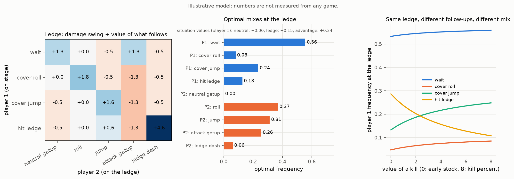
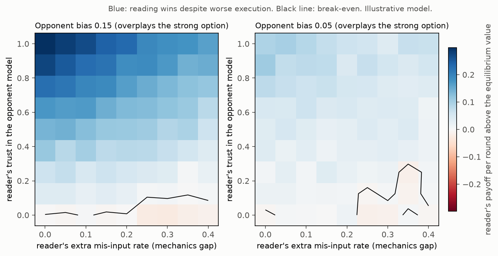
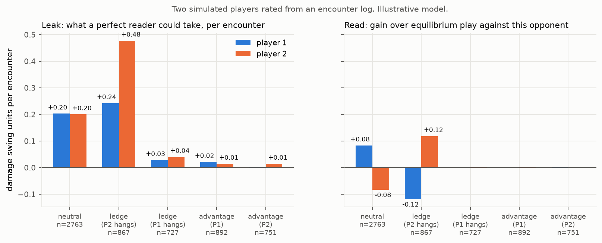

# Fighting games as a chain of situational rock-paper-scissors

Everything below runs on an illustrative model. The option names come from platform fighters, the payoff numbers do not come from any measured game.

## The model

A match is a sequence of encounters. In each one, both players commit to an option at about the same time (a getup option against a cover option, an escape against a combo extension) and the pair of choices decides a damage swing and the next situation. Each encounter is a small zero-sum matrix, so the solver of this repository applies to it, with one twist: the entries are not just the immediate damage. An outcome that sends the opponent back to the ledge is worth the damage plus the value of being at the ledge again, and an outcome that resets to neutral is worth the damage plus the value of neutral.

Formally this is a stochastic game (Shapley, 1953). With a discount `gamma` on the future, the value of each situation solves

    V(s) = value of the matrix [ r(s, a, d) + gamma * sum_s' P(s' | s, a, d) V(s') ]

`explain/fighting_game.py` builds five situations (neutral, ledge trap for each player, advantage for each player), iterates that equation until the values stop moving, and calls `solve_exact` on every matrix. A lost stock is a reward of `KILL` units followed by a reset to neutral.

The consequence is the point of the chapter: two encounters with the same immediate damage table have different optimal mixes when their follow-ups differ. The matrix of an encounter is a property of the game state, not of the move list.

## A worked example: the ledge

Player 2 hangs on the ledge with five options (neutral getup, roll, jump, attack getup, ledge dash). Player 1 stands on stage with four (wait, cover roll, cover jump, hit ledge). Immediate payoffs are damage swings in units of roughly 10%; ledge dash is invincible against most covers but loses hard (a possible kill) to a well-timed hit on the ledge.

With `KILL = 6` and `gamma = 0.9`:

| | neutral | ledge (P1 on stage) | advantage (P1) |
|---|---|---|---|
| value for player 1 | 0.00 | +0.15 | +0.34 |

Optimal ledge mixes: player 1 waits 56%, covers roll 8%, covers jump 24%, hits the ledge 13%. Player 2 never neutral getups, rolls 37%, jumps 31%, attack getups 26%, ledge dashes 6%.

Solving the same table on immediate damage only gives a different answer: player 1 hits the ledge 28% and player 2 ledge dashes 13%. The right panel of the figure sweeps the value of a kill from 0 (early stock, the hit cannot kill) to 8 (kill percent). As the kill gets more valuable, player 2 ledge dashes less (14% to 5%) and player 1 uses the killing option less (29% to 11%), moving that weight to cover jump (13% to 25%). The threat does the work, the killing option itself is used less. This is the same mechanism as the buff figure in the README: an option's frequency is set by what keeps the opponent honest, not by its own strength.

## Mechanics versus reading

Two players repeat the unbalanced 3x3 game. The "mechanic" plays a fixed mix with clean execution but a human-like bias (the strong option A1 is overplayed by 0.15 or 0.05 at the expense of A0). The "reader" mis-inputs more often (with probability `gap` the chosen option is replaced by a random one) but keeps a recency-weighted count of the opponent's options (half-life 200 rounds) and best-replies to it, mixing that reply with the equilibrium according to a trust parameter.

Findings, in payoff per round above the equilibrium value:

- Against the 0.15 bias, a fully trusting reader earns +0.30 with equal execution and still +0.16 with 40% extra mis-inputs. Reading pays for a large mechanics gap.
- Against the 0.05 bias the edge shrinks to +0.09 and +0.07. The break-even line becomes noisy because a bias that small is comparable to the model's own sampling noise over 200 rounds.
- A reader who does not trust the model (trust 0) plays the equilibrium and gains nothing from the bias, while paying for every mis-input. Reading is what converts the opponent's leak into payoff; execution only sets the price.

Caveats: the opponent is stationary, so trusting the model fully has no downside here. Against an adapting opponent, full trust is itself a leak (see `docs/exploitation.md`). Mis-inputs are modelled as uniform random replacements; a whiff that always loses would punish execution more. The size of the edge scales with the opponent's bias, which is the quantity a real analysis would have to measure.

## Rating players from match logs

Given a log of encounters `(situation, option of player 1, option of player 2)`, two numbers per player and situation:

- **Leak**: the exploitability of the player's observed mix, `value - min over opponent replies`. What a perfect reader could take per encounter. It depends only on the player, not on the opponent they faced.
- **Read**: the payoff of the observed mix against the observed opponent, minus the payoff the equilibrium mix would have earned against that same opponent. Positive when the player's deviations were the right ones for this opponent. The two reads in a situation sum to at most zero, so a read is always taken from someone.

In the simulated log, player 1 over-waits at the ledge (leak 0.24) and player 2 jumps into that (leak 0.48 against a best-replier, but a read of +0.12 against this player 1). In neutral, player 2 approaches too much (leak 0.20) and player 1 waits into it (read +0.08). A leak that the opponent does not punish costs nothing; a read is a leak that happens to be pointed at the opponent's leak. Equilibrium play in the advantage situations shows near-zero on both counts.

Data needed for a real analysis: a definition of situations coarse enough to repeat (ledge trap, tech chase, juggle), the option each player chose at each encounter, and payoff estimates per outcome (damage swing, or stock swing scaled by a kill value). The payoffs can be estimated from the outcomes themselves once the situations are labelled.

Sample size matters. The leak measured on a perfectly optimal ledge player, from a finite log, is a pure sampling artefact: 0.23 with 30 encounters, 0.13 with 100, 0.08 with 300, 0.04 with 1000. A leak has to clear that noise floor before it means anything, and it must be compared to the same-size baseline (or bootstrapped) rather than to zero.

## How to run

    python explain/fighting_game.py     # prints the values, mixes and ratings, writes the three figures
    python -m pytest tests/test_fighting_game.py

Edit `build_game` to change options, payoffs and transitions. Every situation may have a different number of options per player.
